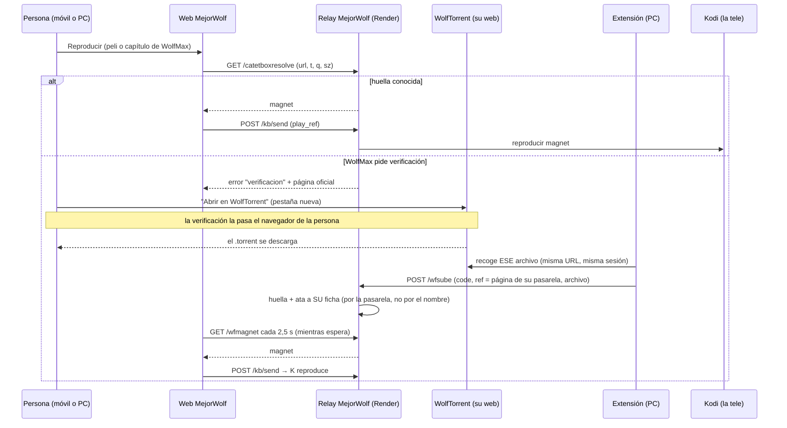

# MejorWolf · WolfTorrent → tele (extensión de Chrome)

Desde el 07-10-2026 WolfMax (ahora **WolfTorrent**) pide una verificación de
Cloudflare antes de cada descarga. **La verificación la pasa tu navegador,
contigo delante; nada de esto la toca ni la imita.** Lo que se automatiza es
todo lo de antes y lo de después.

## El flujo

Cada mañana (07:00) WolfTorrent publica un ZIP con todos los .torrent del día
anterior. La extensión avisa si aún no está subido; al pulsar el aviso se abre su
página y, al descargarlo, la extensión lo entrega igual. Una persona, una vez al
día, vale para todas las teles.

## La interfaz con MejorWolf (comprobada: es nuestro relay)

`POST https://mw-render-relay-6noq.onrender.com/wfsube` · `multipart/form-data`

| campo | | |
|---|---|---|
| `code` | obligatorio | código de 6 cifras de una tele que haya latido en los últimos 60 días |
| `f` | obligatorio | el `.torrent` o el ZIP (≤ 15 MB). Se valida por dentro (bencode con `info`; ZIP con sus `.torrent`, topes anti-ZIP-trampa) |
| `ref` | opcional | la página de la que salió la descarga (`https://wolftorrent.com/descarga/<pelicula\|serie\|documental>/<código>`): ata el torrent a SU ficha |
| `url`, `t`, `q`, `sz` | opcionales | la ficha y lo que la web sabe de ella (título, calidad, tamaño), para comprobar que casa |

Respuestas JSON (nunca un cuerpo vacío):
`200 {ok, tipo:"torrent", nombre, url, ya, link}` · `200 {ok, tipo:"zip", n, dia, emparejados}` ·
`400` no es un .torrent/ZIP · `401` falta el código · `403 {reintentar:true}` código no conocido aún ·
`409` no casa con su ficha · `413` demasiado grande · `429` demasiadas subidas (20 por IP cada 10 min).

`GET /wfmagnet?url=&t=&sz=` → `{link}` si se conoce la huella (la usan la web y
Kodi; solo lectura, nunca encarga trabajo a ninguna tele).

**Dónde se guarda:** solo la huella (infohash), el nombre, el tamaño y de dónde
salió; el `.torrent` no se guarda (con la huella basta para el magnet). En
`/tmp/mw_wfih.json` del relay (Render lo borra en cada despliegue) y en la copia
de `mw-sync` (`/kv/wfih`, D1), que se recupera al arrancar.

## Instalar (modo desarrollador)

1. Chrome → `chrome://extensions` → activa **Modo de desarrollador** (arriba a la derecha).
2. **Cargar extensión sin empaquetar** → elige la carpeta `tools/extension-wolf`.
3. Se abre sola nada más; pulsa el icono → **Opciones** → pon el **código de tu Kodi**
   (el mismo de la web de MejorWolf) → Guardar.
4. (Opcional) fija el icono en la barra: el número rojo/azul son los envíos
   fallidos/pendientes.

## Probarla

1. Automática, sin Chrome: `node tools/pruebas/extension_wolf.js` (carga el
   `background.js` real con un Chrome de mentira: descargas buenas, a medias,
   HTML guardado como .torrent, repetidas, sin código, servidor caído, ZIP, aviso).
2. De verdad:
   - En la web de MejorWolf, reproduce un título de WolfMax que pida verificación →
     **1 · Abrir en WolfTorrent**. El .torrent se descarga; en unos segundos la
     extensión avisa "Enviado a MejorWolf" y la pestaña de MejorWolf lo manda a la tele.
   - Icono de la extensión: debe aparecer con ✅.
   - `/catdiag → wfih`: `origen.persona` sube en 1.

## Qué hace y qué no

- Hace: mira las descargas **terminadas** de `wolftorrent.com` que sean `.torrent`
  o `.zip`; comprueba que estén completas y que por dentro lo sean; las recoge de
  la misma URL con tu sesión (una extensión no puede leer tu carpeta de
  Descargas); las entrega **solo** a MejorWolf; reintenta 1, 5, 15, 60 y 180 min
  sin volver a descargar; no repite envíos (ni por aviso duplicado ni por mismo archivo).
- No hace: no abre WolfTorrent por su cuenta, no pulsa nada, no inyecta código en
  su web (sin content scripts ni `scripting`), no toca su verificación.
- Con Chrome cerrado no corre nada: las alarmas vencidas saltan al abrirlo, y lo
  pendiente se reintenta entonces.
